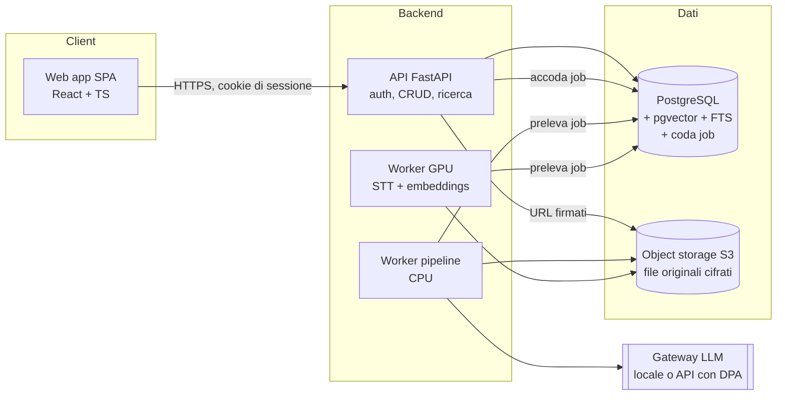
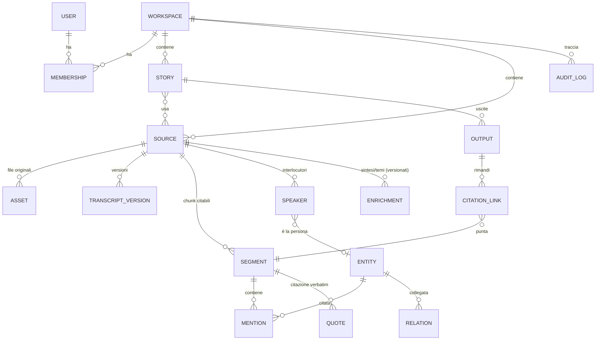
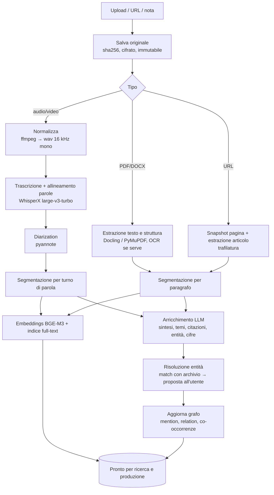

# Design della piattaforma — documento di lavoro (MVP)

> Stato: bozza v0.2 · 7 novembre 2026 — Fasi 0 e 1 implementate (vedi §13)
> Nome provvisorio del progetto: **Redazione** (da definire)

---

## 1. Visione e principi

**Problema.** Il materiale di lavoro di un giornalista è sparso: registrazioni sul telefono, note su carta o app, PDF scaricati, articoli salvati nei preferiti, export di banche dati, mail. Quando si scrive, ritrovare *quella* frase detta da *quella* persona tre mesi fa costa tempo, e il rischio di citare male è concreto. In più la stessa storia oggi va declinata per carta, web e social.

**Proposta.** Un archivio di lavoro unico, organizzato per *storie*, dove ogni materiale diventa una **fonte consultabile e citabile**, e uno **studio di produzione** che aiuta a trasformare quelle fonti in contenuti per canali diversi, **senza che l'AI si sostituisca al giornalista**.

### Principi di prodotto (vincolanti per ogni scelta)

1. **Il giornalista scrive, l'AI prepara.** L'AI trascrive, ordina, collega, cerca, verifica e propone strutture. Non è il punto d'ingresso "genera articolo". La generazione di testo lungo esiste, ma come strumento secondario ed etichettato.
2. **La provenienza è sempre visibile.** Ogni riassunto, citazione, entità o frase suggerita rimanda al punto preciso della fonte (secondo dell'audio, pagina del PDF, paragrafo del web). Se non c'è il collegamento, l'informazione è marcata come non verificata.
3. **Il verbatim è sacro.** La trascrizione originale non viene mai sovrascritta. La versione "ripulita" è un livello derivato. Le citazioni tra virgolette si prendono sempre dal testo verificato, mai da una parafrasi dell'LLM.
4. **Le fonti sono protette per default.** Il segreto professionale e la tutela delle fonti vengono prima di tutto. Il materiale riservato non esce dall'infrastruttura controllata (vedi §7).
5. **Correggere costa poco.** Tutto ciò che l'AI estrae (speaker, entità, temi, date) si corregge con un clic, e la correzione si propaga.

### Cosa NON è

- Non è un chatbot sopra un archivio (RAG generico).
- Non è un generatore automatico di articoli.
- Non è un CMS: non pubblica. Esporta verso il CMS o l'impaginazione.

---

## 2. Utenti e casi d'uso

| Persona | Bisogno principale |
|---|---|
| **Freelance / reporter** | Archivio personale delle interviste, ritrovare citazioni, consegnare pezzi in formati diversi |
| **Redattore di testata** | Lavorare su una storia con più fonti, produrre versioni carta, web e social |
| **Giornalista d'inchiesta** | Collegare persone, enti e fatti nel tempo; massima riservatezza |
| *(post-MVP)* **Caporedattore** | Vedere lo stato delle storie, revisionare, condividere materiali nel team |

**Target dell'MVP:** il singolo giornalista (freelance o redattore) che lavora su più storie. Il modello dati però nasce già *multi-workspace*, così la redazione condivisa si aggiunge senza migrazioni dolorose.

### Casi d'uso chiave (user story)

1. *"Carico la registrazione di un'intervista di 50 minuti e dopo pochi minuti ho il testo diviso per interlocutore, sincronizzato con l'audio, e posso correggerlo."*
2. *"Cerco 'fondi PNRR depuratore' e trovo tutti i passaggi di tutte le interviste e dei documenti in cui se ne parla, anche detto con altre parole."*
3. *"Apro la scheda di una persona e vedo in quali interviste compare, cosa ha detto, chi l'ha nominata e quando."*
4. *"Mentre scrivo il pezzo, trascino una citazione dalla trascrizione nella bozza; resta collegata alla fonte."*
5. *"Dal pezzo per la carta (4.000 battute) ricavo la versione web (titolo SEO, struttura a paragrafi) e un post social. L'AI propone, io decido."*
6. *"Prima di consegnare, chiedo una verifica: l'AI mi segnala le frasi della bozza che non trovano riscontro nelle fonti e le citazioni che non corrispondono al verbatim."*

---

## 3. Funzioni

### 3.1 Mappa funzionale e perimetro MVP

| Area | Funzione | MVP | Dopo |
|---|---|:-:|:-:|
| **Storie** | Creare storie/progetti, assegnarvi fonti, note, stato | ✅ | |
| **Ingestione** | Audio/video (upload + registrazione in-app) | ✅ | |
| | PDF / DOCX / testo | ✅ | |
| | URL web (con snapshot archiviato) | ✅ | |
| | Note libere del giornalista | ✅ | |
| | Banche dati esterne / API (es. registri, open data), email, CSV strutturati | | ✅ |
| **Trascrizione** | Trascrizione con timestamp a livello di parola | ✅ | |
| | Riconoscimento interlocutori (diarization) e nomi degli speaker | ✅ | |
| | Editor trascrizione sincronizzato con audio (clic sulla parola → play) | ✅ | |
| | Versione "pulita" leggibile (derivata, non distruttiva) | ✅ | |
| | Vocabolario personalizzato (nomi, sigle) per migliorare la trascrizione | | ✅ |
| **Analisi** | Sintesi, temi, citazioni salienti con timestamp | ✅ | |
| | Estrazione entità: persone, organizzazioni, luoghi, date, cifre | ✅ | |
| | Unione delle entità ("Mario Rossi" = "l'assessore Rossi") con conferma dell'utente | ✅ | |
| | Raggruppamento per temi tra fonti (clustering) | base | avanzato |
| | Rilevazione di contraddizioni tra fonti | | ✅ |
| **Ricerca** | Ricerca ibrida (parole esatte + semantica) su tutto l'archivio, con filtri | ✅ | |
| | Domande sull'archivio con risposte sempre citate | ✅ | |
| **Connessioni** | Scheda entità (persona/ente) con tutte le occorrenze | ✅ | |
| | Grafo persone–fonti–temi, con filtro temporale | ✅ base | evoluto |
| | Timeline della storia | ✅ base | |
| **Produzione** | Editor bozza con pannello fonti a fianco | ✅ | |
| | Inserimento citazioni collegate (drag & drop dalla trascrizione) | ✅ | |
| | Formati: carta / web / social, con vincoli specifici | ✅ | |
| | Assistenti: scaletta, varianti titolo, adattamento lunghezza/formato | ✅ | |
| | Verifica bozza contro le fonti | ✅ | |
| | Stile della testata (style guide personalizzata) | | ✅ |
| | Export DOCX / Markdown / HTML | ✅ | |
| | Integrazione CMS (WordPress, ecc.) | | ✅ |
| **Collaborazione** | Workspace condivisi, ruoli, commenti, revisione | | ✅ |

### 3.2 Lo studio di produzione nel dettaglio

È qui che il trend "un redattore, tanti formati" diventa prodotto.

- Una **Storia** ha più **Uscite** (output). Ogni uscita ha un *formato* con vincoli espliciti:
  - **Carta**: battute target, occhiello / titolo / sommario, eventuale box.
  - **Web**: titolo SEO e titolo social, meta description, struttura a H2, link interni suggeriti, lettura in X minuti.
  - **Social**: piattaforma (Instagram carosello, LinkedIn, X/Threads thread, script breve per video), con limiti di caratteri e numero di slide.
  - **Newsletter**, **Botta e risposta**.
- Il giornalista scrive in un editor (TipTap) con a fianco il **pannello fonti** della storia: ricerca, citazioni salienti, entità.
- Gli **assistenti AI** sono azioni puntuali, mai un "fai tutto":
  - *Proponi scaletta* a partire dai materiali selezionati (con i rimandi alle fonti per ogni punto).
  - *Trova citazioni su…* (restituisce verbatim con link e timestamp).
  - *Varianti di titolo / attacco* (n proposte, si sceglie).
  - *Adatta* una sezione o un'uscita a un altro formato o a un'altra lunghezza (si vede la differenza e si accetta pezzo per pezzo).
  - *Verifica*: ogni frase viene classificata come *supportata* (con link), *non trovata* o *in contrasto*; ogni citazione tra virgolette viene confrontata con il verbatim.
  - *Cosa manca*: domande rimaste senza risposta, persone citate ma non ascoltate.
- Il testo prodotto dall'AI resta **marcato** nell'editor finché il giornalista non lo modifica o lo accetta. Serve per la trasparenza (AI Act) e per l'onestà intellettuale.

---

## 4. Architettura

### 4.1 Vista d'insieme



### 4.2 Stack consigliato

| Livello | Scelta | Perché | Nella bozza attuale |
|---|---|---|---|
| **Frontend** | **React + TypeScript + Vite** (SPA), TanStack Router + TanStack Query, Tailwind (componenti propri in stile shadcn/ui) | È un'applicazione dietro login: niente SEO né SSR, quindi una SPA è più semplice da gestire e mettere in sicurezza (nessun server Node con segreti). Next.js resta un'alternativa valida se preferito. | Next 14, da rifare |
| Editor | **TipTap** (ProseMirror) con nodi custom "citazione collegata" e "suggerimento AI" | Già scelto, estendibile, supporta la collaborazione (Yjs) in futuro | ✅ mantenere |
| Audio | **wavesurfer.js** | Waveform, regioni per speaker, sincronizzazione con il testo | da aggiungere |
| Grafo | **Cytoscape.js** (o Sigma.js se i nodi diventano tanti) | Layout automatici, filtri, buone prestazioni | — |
| Client API | Tipi generati dall'OpenAPI di FastAPI (`openapi-typescript`) | Un'unica fonte di verità per il contratto | `api.ts` vuoto |
| **Backend API** | **FastAPI** + SQLAlchemy 2 + **Alembic** + Pydantic v2 | Già in uso, ecosistema Python per l'AI | ✅ manca Alembic |
| **Database** | **PostgreSQL 16** + **pgvector** + full-text search in italiano | Un solo database per dati relazionali, vettori, testo e grafo: isolamento per workspace con Row-Level Security, cancellazioni coerenti, backup unico | Postgres + Qdrant |
| Grafo | Tabelle `entity` / `mention` / `relation` in Postgres + CTE ricorsive | Sufficiente per l'MVP; Neo4j/Apache AGE solo se servono query di grafo pesanti | — |
| **Coda job** | Coda su Postgres (**Procrastinate**) | Niente infrastruttura in più, job persistenti con retry (oggi `BackgroundTasks` perde i lavori al riavvio) | BackgroundTasks |
| **File** | Storage compatibile S3 (**SeaweedFS** in locale e sul server del pilota, oppure object storage di un provider UE), mai esposto: i file passano dall'API, con controllo dei permessi e supporto Range | Oggi `/uploads` è servito pubblicamente senza autenticazione | filesystem pubblico |
| **Speech-to-text** | **WhisperX**: faster-whisper `large-v3-turbo` + allineamento a livello di parola + diarization **pyannote** | La qualità sull'italiano e la separazione degli speaker sono il cuore dell'intervista; gira in proprio (tutela fonti) | Whisper `base` su CPU, nessuna diarization |
| **Embeddings** | **BGE-M3** (multilingue, vettori densi + sparsi), self-hosted | Il modello attuale (`all-MiniLM-L6-v2`) è solo inglese: sull'italiano rende poco | MiniLM inglese |
| **LLM** | Gateway astratto (interfaccia unica) con due profili: **cloud** (Claude Sonnet 5.5 per analisi e assistenza, Haiku 5.5 per estrazioni massive, via API con zero data retention e DPA) e **locale** (modello open via vLLM/Ollama) per le fonti riservate | Scelta per livello di riservatezza, non un unico fornitore cablato nel codice | OpenRouter → gpt-4o-mini |
| Output strutturati | Pydantic + JSON schema / tool use nativo | Estrazioni validate | instructor ✅ |
| **Auth** | Sessione con cookie httpOnly/SameSite, password argon2, **2FA TOTP obbligatoria**; in seguito SSO OIDC per le redazioni | Account con materiale sensibile | assente |
| Osservabilità | Log strutturati (senza contenuti delle fonti), Sentry self-hosted o con scrubbing, metriche dei job | | print |
| Deploy | Docker Compose (dev e prime installazioni) → un VPS/GPU in UE; Kubernetes solo se serve | | Compose ✅ |

### 4.3 Perché abbandonare Qdrant (per ora)
Un secondo database significa doppia sorgente di verità: oggi cancellando un'intervista i vettori restano su Qdrant, e gli ID `interview_id * 10000 + idx` collidono oltre i 10.000 segmenti. Inoltre servirebbe replicare a mano l'isolamento per workspace. pgvector con indice HNSW regge senza problemi fino a qualche milione di segmenti, cioè ben oltre l'MVP. Se un giorno servirà, migrare è semplice perché gli embeddings sono rigenerabili.

---

## 5. Modello dati



Entità principali (tutte con `workspace_id`, `created_at`, `created_by`):

- **Source**: `type` (audio, document, web, note, dataset), `title`, `source_date` (*la data dell'intervista o del documento, non quella di caricamento*: è l'asse temporale del grafo), `confidentiality` (`normale` | `riservata` | `segreta`), `status` della pipeline, metadati liberi (luogo, intervistatore, contesto, consenso alla registrazione).
- **Asset**: file originale immutabile (`sha256`, mime, dimensione, chiave sullo storage) + derivati (wav normalizzato, testo estratto, snapshot HTML/PDF della pagina web).
- **Segment**: l'unità citabile. Per l'audio: un turno di parola (start/end in secondi, speaker, parole con timestamp); per i documenti: un paragrafo (pagina e offset). Campi `text_raw` (immutabile), `text_edited` (correzioni umane), `text_clean` (derivato), `embedding`, `tsvector`.
- **Speaker**: interlocutore dentro una fonte (`SPEAKER_00` → "Mario Rossi"), collegabile a un'Entity persona.
- **Entity**: persona, organizzazione, luogo, evento, tema; `aliases`, `description`, `confirmed` (l'utente ha validato).
- **Mention**: entità ↔ segmento (span di caratteri, confidenza, origine AI/umana).
- **Relation**: entità ↔ entità con tipo ("lavora per", "ha nominato", "co-occorrenza"), periodo di validità e segmenti di prova.
- **Quote**: citazione salvata, verbatim, con riferimento al segmento e flag `verified`.
- **Enrichment**: sintesi, temi, citazioni salienti. **Versionato** con `model`, `prompt_version` e `input_hash`, così si può rigenerare e confrontare.
- **Story / Output / CitationLink**: la storia, le sue uscite per formato (contenuto TipTap JSON), e i collegamenti tra porzioni di testo e segmenti.
- **Job**: stato dei passi della pipeline per ogni fonte.
- **AuditLog**: chi ha visto, esportato o cancellato cosa (senza contenuti).

---

## 6. Pipeline dati

### 6.1 Flusso



### 6.2 Regole della pipeline

- **Ogni passo è un job separato**, idempotente e con retry; lo stato è visibile in UI ("trascrizione 60%", "analisi in corso"). Se un passo fallisce, i precedenti restano utilizzabili (es. trascrizione disponibile anche se l'analisi LLM fallisce).
- **Le correzioni umane hanno la precedenza**: se l'utente corregge un nome o uno speaker, i derivati a valle (embeddings, mention, sintesi) vengono ricalcolati solo per i segmenti toccati, e le correzioni non vengono sovrascritte da una nuova esecuzione.
- **La "pulizia" della trascrizione** (togliere intercalari e ripetizioni) è fatta segmento per segmento, con vincolo di non cambiare nomi, numeri e affermazioni; il controllo automatico confronta entità e cifre tra raw e clean e scarta le differenze sospette. Le citazioni si prendono da `text_edited` o `text_raw`, mai da `text_clean`.
- **Le sintesi sono gerarchiche** (per blocco → per fonte) e ogni frase della sintesi porta i riferimenti ai segmenti. La bozza attuale invece concatena i riassunti dei blocchi.
- **Il routing dei modelli dipende dalla riservatezza**: fonti `riservata`/`segreta` → solo modelli locali; `normale` → profilo cloud consentito (configurabile per workspace).
- **Ricerca ibrida**: BM25 (FTS italiano) + vettori densi, fusione RRF, re-ranking opzionale; filtri per storia, fonte, speaker, entità, intervallo di date.
- **Le domande sull'archivio** rispondono solo con citazioni verificabili; se il materiale non basta lo dicono. Il testo delle fonti è trattato come dato (difesa da prompt injection presente in pagine web o PDF): l'LLM non ha strumenti con effetti collaterali.

### 6.3 Ordini di grandezza (stima per budget)
- 1 ora di audio con WhisperX su una GPU di fascia media: ~2–4 minuti di trascrizione + ~1–2 minuti di diarization.
- 1 ora di intervista ≈ 9–10k parole ≈ 13k token; l'arricchimento con un modello di fascia media costa pochi centesimi per ora di audio.
- Embeddings: trascurabili su GPU.

---

## 7. Sicurezza, privacy e aspetti legali

### 7.1 Modello di minaccia (cosa proteggiamo, da chi)

| Asset | Rischio | Conseguenza |
|---|---|---|
| Identità delle fonti confidenziali | Data breach, accesso non autorizzato, fornitore terzo | Danno grave alle persone, violazione del segreto professionale |
| Materiale non pubblicato | Fuga di notizie, concorrenza | Danno editoriale/economico |
| Dati personali di terzi nelle interviste | Trattamento illecito | Sanzioni GDPR |
| Integrità delle fonti | Manipolazione di trascrizioni/citazioni | Errori pubblicati, querele |

### 7.2 Misure

**Accesso e isolamento**
- Autenticazione forte (2FA obbligatoria), sessioni brevi revocabili, rate limiting sul login.
- `workspace_id` su ogni riga + **Row-Level Security** in Postgres: anche un bug nell'API non deve far leggere dati di un altro workspace.
- Nessun file servito staticamente: download e riproduzione solo attraverso l'API, dopo il controllo dei permessi; lo storage non è raggiungibile dall'esterno.

**Cifratura**
- TLS ovunque; cifratura a riposo di database, storage e backup.
- Fonti `segreta`: cifratura per-workspace con chiavi gestite (envelope encryption), esclusione dai log e dalle anteprime.

**Fornitori AI**
- STT ed embeddings self-hosted di default.
- LLM cloud solo con DPA, zero data retention, nessun addestramento sui dati, regione UE quando disponibile; disattivabile per workspace e per singola fonte.
- Registro di quali dati sono stati inviati a quale modello (per fonte).

**Integrità e tracciabilità**
- Originali immutabili con hash; versioni della trascrizione; audit log di accessi, export e cancellazioni.
- Testo AI marcato fino all'accettazione umana.

**Ciclo di vita del dato**
- Cancellazione vera e a cascata (DB, vettori, file, derivati) con conferma; politica di retention per i backup documentata.
- Export completo dei propri dati (portabilità, nessun lock-in).

**Applicazione**
- Validazione del tipo di file sul contenuto (non sull'estensione), limiti di dimensione, ffmpeg in un processo isolato.
- Fetch degli URL con protezione SSRF (blocco IP interni), timeout, limiti di dimensione.
- Segreti fuori dal repository (oggi le credenziali del DB sono nel compose e nel codice).
- Dipendenze fissate e scansionate.

### 7.3 Quadro normativo da considerare (da validare con un legale)
- **GDPR** art. 85 e **Codice privacy** art. 136 e seguenti: deroghe per finalità giornalistiche, che però non esonerano dalla sicurezza del trattamento. **Regole deontologiche** relative al trattamento dei dati personali nell'esercizio dell'attività giornalistica.
- **Segreto professionale sulle fonti** (L. 69/1963 art. 2; art. 200 c.p.p.): progettare in modo che il fornitore della piattaforma non possa accedere ai contenuti (minimo accesso operativo, cifratura, log).
- **AI Act (Reg. UE 2024/1689)**: obblighi di trasparenza sui contenuti generati dall'AI; la marcatura e la tracciabilità del testo AI rispondono a questo.
- **Consenso alla registrazione** e informativa agli intervistati: campo dedicato nei metadati della fonte.
- **Diritto d'autore**: gli snapshot di pagine web e i materiali di terzi restano a uso interno di documentazione.

---

## 8. UX: struttura dell'interfaccia (per il nuovo frontend)

```
┌───────────────────────────────────────────────────────────────────┐
│ ⌘K ricerca globale                         workspace ▾   profilo  │
├──────────┬────────────────────────────────────────────────────────┤
│ Storie   │  STORIA: "Depuratore di Valle Verde"                   │
│ Archivio │  [Fonti] [Persone & enti] [Grafo] [Timeline] [Uscite]  │
│ Persone  │                                                        │
│ Grafo    │  …contenuto della vista…                               │
│ Ricerca  │                                                        │
└──────────┴────────────────────────────────────────────────────────┘
```

Schermate dell'MVP:
1. **Home / Storie**: elenco delle storie con stato, ultime fonti caricate, job in corso.
2. **Archivio fonti**: tabella filtrabile (tipo, data, storia, persona, riservatezza), caricamento con drag & drop, registrazione dal browser.
3. **Vista fonte audio**: waveform con regioni per speaker · trascrizione editabile sincronizzata · pannello laterale con sintesi, temi, entità e citazioni salienti (ognuna cliccabile → salta al punto).
4. **Vista fonte documento/web**: testo con evidenziazioni delle entità, rimando al PDF o allo snapshot originale.
5. **Scheda entità**: chi è, alias, in quali fonti compare, cosa ha detto (citazioni), con chi è collegata, linea del tempo.
6. **Grafo**: persone/enti/fonti/temi, filtri per storia e periodo, slider temporale; clic su un arco → i segmenti che lo provano.
7. **Ricerca**: risultati ibridi raggruppati per fonte, con estratti evidenziati; modalità "domanda" con risposta citata.
8. **Studio di produzione**: editor a sinistra · pannello fonti a destra · barra dei formati (Carta / Web / Social) · contatori di battute e vincoli · azioni AI contestuali · verifica.

Criteri di design: densità da strumento di lavoro (non da landing page), tastiera prima di tutto (⌘K, scorciatoie nel player: play/pausa, ±5 s, velocità), tema chiaro e scuro, accessibilità AA, prestazioni su trascrizioni di 2–3 ore (virtualizzazione della lista dei segmenti).

---

## 9. Stato della bozza attuale e cosa recuperare

**Da tenere (concetti e codice):** FastAPI + Postgres, upload asincrono, segmenti con timestamp, prompt del polisher (regole di fedeltà), output strutturati con instructor/Pydantic, TipTap, registratore audio in-app.

**Problemi da risolvere:**
- 🔴 **Nessuna autenticazione**; `/uploads` servito pubblicamente: chiunque raggiunga l'API scarica gli audio.
- 🔴 Nel repository ci sono **file audio di terzi** (`backend/uploads/*.mp3`, tra cui un brano musicale e una puntata TV): vanno rimossi anche dalla storia di git prima di condividere il repo. Lo stesso vale per `__pycache__/` e `frontend/.next/`, che sono tracciati.
- 🔴 Credenziali del database scritte nel codice e nel compose.
- 🟠 Whisper `base` su CPU e nessuna diarization: qualità insufficiente per le interviste.
- 🟠 Embeddings solo in inglese su contenuti in italiano.
- 🟠 Cancellando un'intervista i vettori restano su Qdrant; possibili collisioni di ID.
- 🟠 `BackgroundTasks`: i job si perdono al riavvio e non si possono riprovare.
- 🟠 La bozza viene generata dai soli riassunti: rischio di citazioni inventate e nessun collegamento alle fonti.
- 🟡 Il polisher costruisce `PolishedSegment(raw_text=...)` e `polished_full_text`, campi che lo schema non definisce (vengono ignorati silenziosamente); la versione pulita sovrascrive di fatto quella usata per la ricerca.
- 🟡 Nessuna migrazione (Alembic), nessun test, `Base.metadata.create_all` all'avvio.

**Decisione proposta:** frontend riscritto da zero; backend **rifondato** (nuovo schema, auth, coda, storage) riusando i servizi esistenti come punto di partenza, non incrementale sul vecchio `main.py`.

---

## 10. Piano di lavoro MVP

| Fase | Contenuto | Esito verificabile |
|---|---|---|
| **0. Pulizia** | Rimozione audio, cache e build dal repo (anche dalla storia), `.env.example`, struttura `apps/api`, `apps/web`, `workers/` | Repo pulito, avvio con `docker compose up` |
| **1. Fondamenta** | Schema + Alembic, auth con 2FA, workspace + RLS, storage S3 (SeaweedFS), coda job, scheletro del nuovo frontend (layout, routing, design system, client API tipizzato) | Login, creazione storia, upload sicuro di un file |
| **2. Audio** | Pipeline WhisperX + diarization, vista fonte audio con editor sincronizzato, rinomina speaker, versione pulita | Intervista di 1 h trascritta, corretta e navigabile |
| **3. Documenti, web, ricerca** | Ingestione PDF/DOCX/URL/note, embeddings BGE-M3 + FTS, ricerca ibrida, domande con citazioni | Ricerca trasversale con salto al punto della fonte |
| **4. Entità e grafo** | Estrazione e risoluzione entità, schede persona/ente, grafo base, timeline | "Dove compare X e cosa ha detto" in un clic |
| **5. Studio di produzione** | Uscite per formato, citazioni collegate, assistenti (scaletta, titoli, adattamento), verifica, export | Pezzo carta + web + social dalla stessa storia |
| **6. Pilota** | 3–5 giornalisti veri, raccolta feedback, metriche | Decisione su cosa sviluppare dopo |

**Metriche del pilota:** tempo da "audio caricato" a "prima citazione usata"; correzioni manuali per ora di audio (qualità STT); quota delle citazioni pubblicate che risultano collegate a una fonte; uso settimanale; quali assistenti AI vengono usati e quali ignorati.

---

## 11. Decisioni aperte

| # | Domanda | Proposta di default |
|---|---|---|
| 1 | Target del primo pilota: freelance singoli o una redazione? | **Deciso:** una redazione locale (3–5 redattori, tramite un contatto interno). Vedi §12 |
| 2 | Hosting: cloud UE gestito, server della redazione o entrambi? | **Deciso per il pilota:** server dedicato con GPU in UE, gestito con Dokploy (§12); on premise presso la redazione come opzione futura |
| 3 | È accettabile un LLM cloud per le fonti "normali"? | Sì, con zero retention; locale obbligatorio per le riservate |
| 4 | Lingue | Italiano come lingua principale, inglese supportato (WhisperX e BGE-M3 sono multilingue) |
| 5 | Budget GPU per lo STT | Una GPU in affitto on-demand; fallback su CPU (più lento) per lo sviluppo |
| 6 | Nome e identità del prodotto | da definire |

---

## 12. Pilota con la redazione e hosting

### 12.1 Cosa cambia con un pilota in redazione
- **Collaborazione anticipata nell'MVP**: workspace di redazione condiviso, ruoli `redattore` e `caporedattore`, fonti condivise tra colleghi. Commenti e flussi di revisione restano post-MVP.
- **Perimetro del pilota**: fasi 1–3 più il minimo della fase 5 (editor con citazioni collegate, uscite carta/web/social, export). Grafo, assistenti avanzati e verifica completa arrivano in una seconda iterazione, guidati dai feedback.
- **Prima del codice, un incontro di scoperta** (30–45 minuti con 2–3 redattori) per validare il perimetro.
- **Ruoli GDPR**: il giornale è titolare del trattamento, noi responsabile (art. 28). Serve un accordo sul trattamento dei dati con l'elenco dei sub-responsabili (hosting, eventuale LLM cloud), il luogo dei dati e la cancellazione a fine test.
- **Fine pilota**: export completo dei materiali alla redazione, poi cancellazione certificata dal server (backup compresi, secondo la retention dichiarata) se non si prosegue.

### 12.2 Terminologia
- **On premise** = sui server della redazione. Richiede il loro IT: è un'opzione futura.
- **Self-hosted in UE** = server dedicato presso un provider europeo, gestito da noi: è la scelta per il pilota. Lo stack in container rende possibile portarlo on premise senza riscritture.

### 12.3 Infrastruttura
| Voce | Scelta | Note |
|---|---|---|
| Server | Un solo server dedicato con GPU in UE (16–24 GB VRAM, 64 GB RAM, 1–2 TB NVMe) | Ospita API, Postgres, worker, storage S3, frontend. Ordine di grandezza ~200 €/mese, da verificare sulle offerte attuali |
| Alternativa | Server CPU per l'app + worker GPU noleggiato a ore | Conveniente solo con poco audio; più complessità |
| Orchestrazione | **Dokploy** (Traefik, TLS automatico, deploy da git, variabili d'ambiente, backup Postgres verso S3) | |
| GPU nei container | `nvidia-container-toolkit` + `deploy.resources.reservations.devices` nel compose | Il worker GPU va deployato come servizio **Docker Compose**, non come applicazione Swarm (Swarm gestisce male le GPU) |
| Ambienti | Locale (sviluppo) + produzione; staging facoltativo come progetto Dokploy separato, con dati finti | |
| Dominio | Sottodominio dedicato al pilota, solo HTTPS | |

### 12.4 Messa in sicurezza del server
- **Pannello Dokploy mai esposto su internet**: raggiungibile solo via VPN (Tailscale/WireGuard) o IP consentiti, con 2FA, aggiornato.
- Firewall: aperte solo le porte 80 e 443. SSH solo con chiave, preferibilmente solo via VPN. Postgres, lo storage e i servizi interni mai pubblicati.
- **Cifratura del disco** con LUKS e sblocco remoto all'avvio (es. dropbear in initramfs).
- **Backup cifrati** (restic per i file, pgBackRest o i backup Dokploy per Postgres) verso un secondo provider o una seconda località in UE; **prova di ripristino prima dell'avvio del pilota** e poi una volta al mese.
- Aggiornamenti automatici di sicurezza del sistema operativo; immagini Docker con versioni fissate e aggiornate a cadenza regolare.
- Monitoraggio: disponibilità (Uptime Kuma), disco, RAM, GPU, stato e durata dei job, con avvisi.
- Log senza contenuti delle fonti; accesso amministrativo registrato.
- DPA con il provider di hosting, citato nell'accordo con il giornale.

### 12.5 LLM durante il pilota
È l'unico componente che può far uscire dati dal server. Due opzioni da decidere con il referente della redazione:
1. **Ibrida**: LLM cloud con zero data retention e DPA per i materiali "normali"; modello locale sulla stessa GPU per quelli riservati.
2. **Solo locale**: tutto sul server. È più semplice da spiegare e da garantire, ma la qualità è un po' inferiore e la GPU va condivisa con la trascrizione (i job vanno messi in coda con priorità).

In entrambi i casi il gateway LLM resta astratto, così il passaggio da un'opzione all'altra è una configurazione e non una riscrittura.

### 12.6 Checklist prima di aprire il pilota
- [ ] Accordo sul trattamento dei dati firmato
- [ ] Server con disco cifrato, firewall, VPN per l'amministrazione
- [ ] Backup configurati e ripristino provato
- [ ] Account dei redattori con 2FA attiva
- [ ] Scelta sull'LLM (ibrida o solo locale) concordata e configurata
- [ ] Formazione iniziale fatta
- [ ] Procedura di export e cancellazione di fine test scritta

---

## 13. Registro di implementazione

### Fasi 0 e 1 — 7 novembre 2026
**Fatto**
- Repository ripulito: vecchio frontend rimosso, vecchio backend spostato in `legacy/` come riferimento, audio di prova, cache e build tolti dal tracciamento; nuova struttura `apps/api`, `apps/web`, `infra/`.
- Backend: schema con identità, workspace, storie, fonti e file; migrazioni Alembic; Row-Level Security su tutte le tabelle di lavoro con ruolo applicativo senza privilegi; FK composte contro i collegamenti tra workspace; audit log in sola aggiunta.
- Autenticazione: argon2id, 2FA TOTP obbligatoria con codici di recupero, sessioni in cookie con rotazione del token, limite ai tentativi, controllo `Origin`.
- File: upload con riconoscimento del tipo dal contenuto, hash SHA-256, storage S3, streaming con Range per il player, cancellazione a cascata anche nello storage.
- Coda job su Postgres (Procrastinate) con worker separato; job di ingestione di base, punto d'aggancio per la pipeline della Fase 2.
- Frontend: accesso e configurazione 2FA, elenco e dettaglio storie, archivio fonti con filtro, caricamento con trascinamento e avanzamento, riproduzione audio/video, note, tema chiaro/scuro, layout mobile.
- 18 test automatici (auth, isolamento RLS anche aggirando l'API, upload/riproduzione/cancellazione).

**Scostamenti dal design**
- **SeaweedFS al posto di MinIO**: le immagini Docker ufficiali di MinIO non sono più distribuite pubblicamente. SeaweedFS è Apache 2.0 e compatibile S3; il codice usa l'API S3 standard, quindi il fornitore resta sostituibile.
- **Niente URL firmati**: i file passano dall'API. Lo storage resta privato e ogni accesso è controllato e, per i download, registrato.
- **Componenti UI propri** invece della CLI di shadcn/ui: stessi principi, meno dipendenze.

**Da fare più avanti**
- Protezione dal riutilizzo di un codice TOTP nella stessa finestra di 30 secondi.
- Limite ai tentativi condiviso (Postgres/Redis) se l'API girerà su più istanze.
- Job periodico che rimette in coda le fonti rimaste nello stato "uploaded".
- Gestione dei membri del workspace dall'interfaccia (oggi da riga di comando).

### Fase 2 — 7 novembre 2026
**Fatto**
- Modello dati: versioni della trascrizione (`transcripts`), interlocutori (`speakers`) e segmenti citabili (`segments`) con verbatim immutabile, correzione umana e versione pulita separati; parole con tempi e probabilità; RLS e FK composte come per le altre tabelle.
- Pipeline: l'ingestione di audio e video mette in coda la trascrizione su una coda dedicata (`stt`), servita da un worker separato con ffmpeg (immagine `stt`, un file alla volta). Normalizzazione a WAV 16 kHz mono, forma d'onda ridotta per il player, trascrizione con tempi per parola, avanzamento visibile, errori leggibili.
- Diarization con pyannote, opzionale: si attiva con l'immagine costruita con `WITH_DIARIZATION=1`, `DIARIZATION_ENABLED=true` e un token Hugging Face. Le parole vengono assegnate al turno con la sovrapposizione maggiore. Senza diarization ogni frase è un passaggio a sé, da assegnare a mano.
- Versioni: ritrascrivere crea una nuova versione, che diventa corrente solo quando è pronta. Le correzioni restano nella versione su cui sono state fatte e si può tornare a una versione precedente.
- Versione pulita (on demand): gateway LLM compatibile OpenAI con instradamento per riservatezza. Il cloud è ammesso solo per le fonti normali, mentre le riservate e le segrete vanno solo al modello locale. Ogni passaggio pulito passa un controllo automatico su cifre, nomi propri e lunghezza; se non lo supera resta il verbatim. Il prompt tratta il testo come dato.
- Vista fonte audio/video:
  - player con forma d'onda e fasce colorate per interlocutore, velocità e ±5 s;
  - scorciatoie da tastiera;
  - parola corrente evidenziata durante l'ascolto e clic su una parola per ascoltarla;
  - parole incerte sottolineate;
  - correzione dei passaggi con ripristino del verbatim;
  - interlocutori: nome, assegnazione, nuovo, unione;
  - selettore di versione;
  - export TXT e SRT, tracciato nell'audit.
- 31 test automatici: segmentazione, controlli della versione pulita, instradamento per riservatezza, flusso completo con motore finto, versioni, isolamento.

**Scostamenti dal design**
- **faster-whisper + pyannote invece di WhisperX**: stessa sostanza (Whisper su CTranslate2, tempi per parola, VAD, diarization pyannote) con meno dipendenze fragili. L'allineamento fonetico wav2vec2 di WhisperX si può aggiungere se i tempi delle parole risultano imprecisi sulle interviste vere.
- **Versione pulita su richiesta**, non automatica: il giornalista decide quando mandare il testo al modello linguistico.
- **Niente virtualizzazione della lista**: le righe usano `content-visibility: auto` e l'evidenziazione della parola agisce direttamente sul DOM. Va verificato su una trascrizione di 2–3 ore.

**Verificato a mano**
- Intervista sintetica di 77 secondi (voci di sintesi italiane), trascritta su CPU con il modello `small` in circa 30 secondi: numeri e nomi resi correttamente.
- Le voci di sintesi più robotiche (es. "Reed" di macOS) non vengono riconosciute da Whisper: per le prove servono voci naturali o registrazioni vere.

**Da fare più avanti**
- Dividere e unire passaggi (oggi si correggono testo e interlocutore, non i confini).
- Collaudo della diarization con un token Hugging Face e audio reale; prova su un'intervista di un'ora (tempi su CPU e su GPU).
- Immagine `stt` con base CUDA per il server con GPU; modelli scaricati in anticipo e `HF_HUB_OFFLINE=1` in produzione.
- Vocabolario personalizzato (nomi, sigle) passato al modello come contesto iniziale.
- Modifiche concorrenti allo stesso passaggio: oggi vince l'ultima.

### Fase 3 — 7 novembre 2026
**Fatto**
- **Gateway LLM per funzione**: ogni funzione ha un livello (semplice, medio, difficile) e tre profili (`local`, `cloud_fast`, `cloud_strong`). Se il contesto contiene anche una sola fonte riservata si usa solo il locale. I compiti semplici preferiscono il locale anche per le fonti normali.
- **Documenti**: PDF (pypdfium2), DOCX, ODT e testo diventano paragrafi citabili con la pagina, ricostruendo i paragrafi dalle righe impaginate e riunendo le parole spezzate. Le pagine senza testo passano dall'OCR (tesseract ita+eng), con un avviso nell'interfaccia. I paragrafi si correggono come i passaggi audio. Il PDF si apre nel visualizzatore del browser alla pagina giusta.
- **Pagine web**: acquisizione con protezioni SSRF (vedi sotto). Si salvano una copia della pagina (servita in sandbox) e il testo dell'articolo (trafilatura), con titolo, autore, data, sito, indirizzo finale e ora di acquisizione. Le tabelle diventano paragrafi leggibili. Un link a un PDF viene trattato come documento.
- **Note**: il testo diventa subito cercabile, diviso in paragrafi.
- **Modello unico per il testo**: documenti, web e note usano le stesse versioni e gli stessi segmenti dell'audio, con `page` al posto dei tempi. Correzioni, versioni, export e ricerca funzionano allo stesso modo per tutti i tipi.
- **Ricerca ibrida**:
  - full-text di Postgres in italiano (colonna generata + GIN) unito agli embeddings BGE-M3 (pgvector, HNSW) con Reciprocal Rank Fusion;
  - filtri per tipo, storia e periodo;
  - estratti con le parole evidenziate;
  - ricerca solo nella versione corrente del testo;
  - soglia di similarità (0,45) tarata su dati reali, per scartare i risultati "per significato" che non c'entrano.
- **Embedder**: servizio interno (stessa immagine del worker di trascrizione), senza porte esposte. Gli embeddings si ricalcolano quando un passaggio viene corretto. Se l'embedder non risponde, la ricerca prosegue solo per parole e lo dice.
- **Domande sull'archivio**:
  - recupero dei passaggi (OR sulle parole significative + significato), risposta con rimandi [n] cliccabili;
  - i rimandi a passaggi inesistenti vengono rimossi;
  - le citazioni «…» non presenti alla lettera nei passaggi vengono segnalate;
  - senza modello disponibile si mostrano comunque i passaggi pertinenti;
  - nel registro di audit c'è chi ha chiesto e quale modello ha risposto, mai la domanda.
- **Interfaccia**:
  - pagina Ricerca (Cerca / Chiedi all'archivio, ⌘K);
  - lettore per documenti, web e note;
  - "Link" nell'archivio e nelle storie;
  - un risultato apre la fonte sul passaggio: per l'audio il player si posiziona al secondo giusto.
- **Comando `reindex`** per i dati caricati prima di questa fase.
- 53 test automatici.

**Sicurezza delle pagine web (SSRF)**
- Solo http/https sulle porte 80 e 443, niente credenziali nell'indirizzo.
- Si risolve il nome e si rifiutano gli indirizzi non pubblici (rete interna, localhost, metadati cloud, nomi dei container), a ogni redirect (al massimo 5).
- Limiti di 15 MB e 20 secondi.
- Resta un rischio residuo di DNS rebinding tra controllo e connessione: in produzione il worker deve stare su una rete con uscita filtrata (solo Internet pubblico).

**Verificato a mano**
- Verbale scansionato e leggermente storto: testo letto dall'OCR senza errori, paragrafi ricostruiti.
- Pagina di Wikipedia acquisita, con copia salvata e metadati.
- Ricerca per significato sull'intervista Biagi–Agnelli (40 minuti): "cosa pensa della politica italiana" trova passaggi senza parole in comune. Tempi di risposta 0,1–0,2 s.
- `http://localhost:…` rifiutato.

**Modelli linguistici configurati in sviluppo**
- Locale: Ollama nel compose con `qwen2.5:3b` su CPU. Serve solo a provare il percorso delle fonti riservate: è lento (circa 70 s per pulire 9 frasi) e scarso nelle risposte. Sul server del pilota si sceglierà un modello più capace su GPU.
- Cloud: OpenRouter, con Claude Haiku 5.5 (veloce) e Claude Sonnet 5.5 (forte), per sviluppare e confrontare i modelli su dati di prova o pubblici. Per il pilota la scelta (OpenRouter con restrizioni sulla conservazione dei dati oppure contratto diretto con il fornitore) va concordata con la redazione.
- Prova reale: alla domanda sulla cassa integrazione nell'intervista Biagi–Agnelli, Sonnet ha risposto citando i passaggi, ma ha rifiutato di attribuire le frasi ad Agnelli perché la trascrizione (senza riconoscimento delle voci) le assegna tutte a un solo interlocutore. È la conferma che la diarization è necessaria per le interviste.

**Riconoscimento delle voci attivato**
- Token Hugging Face fine-grained (sola lettura dei repository con licenza accettata) e pyannote `speaker-diarization-community-1` nel worker `stt`.
- "Riconosci le voci" su una trascrizione esistente: non ritrascrive, conserva testo e correzioni, divide i passaggi non corretti in cui parlano due persone, sostituisce gli interlocutori con "Voce 1", "Voce 2"…
- Se la diarization fallisce durante una trascrizione nuova, la trascrizione resta valida con una sola voce e l'errore viene registrato.
- Intervista Biagi–Agnelli (18 minuti): 2 voci riconosciute, 11 passaggi divisi, attribuzioni corrette nei passaggi controllati. Su CPU (Mac, Docker) ci sono voluti circa 13 minuti; su GPU servirà circa un minuto.
- Stessa domanda sulla cassa integrazione prima e dopo. Prima Sonnet si rifiutava di attribuire le frasi, perché risultavano tutte di Biagi. Dopo risponde attribuendole ad Agnelli, distingue la domanda di Biagi, segnala il passaggio trascritto male da verificare sul video, e tutte le citazioni risultano verificate.

**Da fare più avanti**
- Anteprima del PDF dentro l'app (pdf.js) con evidenziazione del paragrafo; oggi si apre nel visualizzatore del browser alla pagina giusta.
- Copia della pagina web più fedele (PDF o screenshot con un browser headless); oggi è l'HTML scaricato, senza immagini né stili esterni.
- Riordino dei risultati con un cross-encoder locale, se la qualità della ricerca lo richiede.
- Le domande sono sincrone (10–30 s con un modello cloud): coda e streaming se servono tempi più lunghi.
- Taratura della soglia di similarità su più materiale reale.
